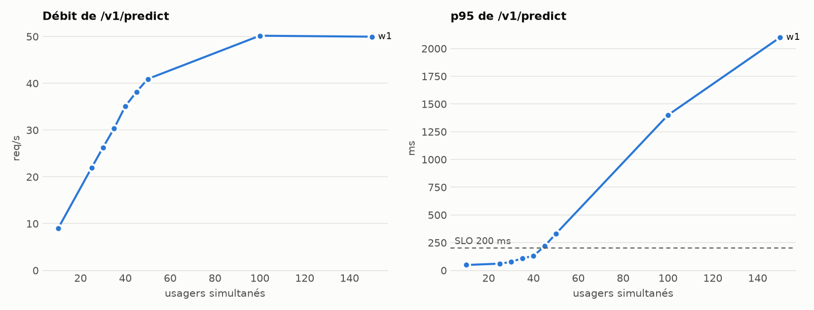

# velov-mlops

Projet fil rouge du cours **Industrialisation de l'IA dans le Cloud** (M2 Data Engineering / IA).

Objectif métier : prédire, pour chaque station Vélo'v, le nombre de vélos disponibles **dans une heure**,
et servir cette prédiction via une API fiable, conteneurisée, puis déployée (on-premise et cloud).

## Progression par session

Chaque étape du cours correspond à un tag git. Absent ou bloqué : repartez du tag de fin de la session précédente.

| Tag | Contenu |
|---|---|
| `s1-start` | Données simulées, features, entraînement. API à compléter (TP1) |
| `s1-end` | Modèle v0 servi par FastAPI, tests pytest |

```bash
git checkout s1-end          # récupérer l'état de fin de S1
git checkout -b mon-binome   # travailler sur sa propre branche
```

## Démarrage rapide

Prérequis : Python 3.11+ (3.12 recommandé), git. Docker sera nécessaire en S2.

```bash
python -m venv .venv
source .venv/bin/activate            # Windows : .venv\Scripts\activate
pip install -r requirements-dev.txt
pip install -e .                     # rend le package velov importable

python -m velov.data                 # génère data/velov_history.csv (simulateur, seed fixe)
python -m velov.train                # entraîne et écrit models/model.joblib + models/metadata.json
python -m velov.train --mlflow       # idem + journalisation MLflow (puis : mlflow ui)
pytest                               # tests
uvicorn velov.api.main:app --reload  # API sur http://127.0.0.1:8000/docs (--reload : en dev uniquement)
```

Exemple d'appel :

```bash
curl -X POST http://127.0.0.1:8000/v1/predict \
  -H "Content-Type: application/json" \
  -d '{"station_id": 3, "timestamp": "2026-10-06T08:00:00+02:00", "capacity": 20,
       "bikes_available": 12, "temperature": 14.5, "is_raining": false}'
```

Le `timestamp` doit porter un fuseau (`+02:00`, `Z`...) : sans fuseau, l'API répond 422.
Les instants sont renvoyés et journalisés en UTC (`"target_timestamp": "2026-10-06T07:00:00Z"`).

## Lancer avec Docker (S2)

Le modèle est embarqué dans l'image : il faut l'entraîner **avant** le build.

```bash
python -m velov.data && python -m velov.train     # crée models/model.joblib + metadata.json
cp .env.example .env

docker build -t velov-api:0.1.0 .
docker run -d --name vt -p 8000:8000 --env-file .env velov-api:0.1.0

docker ps                                  # STATUS doit passer à (healthy)
curl http://localhost:8000/health          # le process répond
curl http://localhost:8000/ready           # le modèle est chargé
curl -X POST http://localhost:8000/v1/predict   -H "Content-Type: application/json"   -d '{"station_id": 3, "timestamp": "2026-10-06T08:00:00+02:00", "capacity": 20,
       "bikes_available": 12, "temperature": 14.5, "is_raining": false}'

docker logs vt                             # lire ce que dit l'application
docker stop vt && docker rm vt             # arrêter
```

En cas de problème, méthode dans l'ordre : `docker ps -a`, `docker logs`, `docker exec`, `docker inspect`.

## Lancer avec Compose : API + PostgreSQL (S2)

Chaque prédiction est enregistrée dans une table `predictions` (EX-08).

```bash
python -m velov.data && python -m velov.train     # crée models/model.joblib + metadata.json
cp .env.example .env                              # puis fixer un vrai POSTGRES_PASSWORD

docker compose up --build -d
docker compose ps                                  # les deux services doivent passer healthy

curl http://localhost:8000/ready
curl -X POST http://localhost:8000/v1/predict \
  -H "Content-Type: application/json" \
  -d '{"station_id": 3, "timestamp": "2026-10-06T08:00:00+02:00", "capacity": 20,
       "bikes_available": 12, "temperature": 14.5, "is_raining": false}'

# vérifier que la prédiction est bien en base
docker compose exec db psql -U velov -c "SELECT id, station_id, predicted_bikes, model_version, created_at FROM predictions;"

docker compose logs -f api                          # lire les logs
docker compose down                                 # arrêter, les données restent (volume pgdata)
docker compose down -v                               # arrêter et effacer les données
```

Si `DATABASE_URL` n'est pas définie, ou si la base est indisponible, l'API démarre et prédit
quand même : l'échec d'écriture est seulement journalisé (`docker compose logs api`), jamais
renvoyé au client (EX-07).

## Pipeline de données (S3)

```
CSV / collecte --ingest--> bronze.velov_raw --dbt--> silver.stg_observations --dbt--> gold.gold_hourly_features --> train.py
 (brut, tel que reçu)      (PK station+instant)      (propre, 1 ligne / station / heure)   (contrat enforced)       (contrat Pandera)
```

| Couche | Rôle | Garantie |
|---|---|---|
| bronze | données brutes, jamais corrigées | idempotente : clé primaire + `ON CONFLICT DO NOTHING` |
| silver | heure pleine, dédoublonnage, lignes incohérentes écartées | une ligne par (station, heure) |
| gold | table d'entraînement : colonnes du contrat + `bikes_next_hour` | schéma figé (`contract.enforced`), tests dbt |

```bash
pip install -r requirements-dev.txt && pip install -e .
cp .env.example .env                      # fixer POSTGRES_PASSWORD
set -a; . ./.env; set +a                  # PowerShell : $env:POSTGRES_PASSWORD="..."
docker compose up -d db                   # PostgreSQL, publié sur 127.0.0.1:5432 uniquement
python -m velov.data                      # génère data/velov_history.csv
python -m velov.ingest                    # 1er passage : N lignes nouvelles
python -m velov.ingest                    # 2e passage  : 0 ligne nouvelle (idempotent)
cd dbt/velov && dbt build --profiles-dir . && cd ../..   # silver + gold + tests
python -m velov.train --source gold       # lit gold, vérifie le contrat Pandera, entraîne
```

Vérifier l'idempotence de bout en bout (EX-10) : l'empreinte doit être identique avant et après un rejeu.

```bash
docker compose exec db psql -U velov -At -c "select md5(string_agg(t::text,'|' order by station_id, timestamp)) from gold.gold_hourly_features t"
```

Choix de conception : les features dérivées (heure, jour, `occupancy_rate`) ne sont **pas** calculées en SQL.
Elles restent dans `velov.features`, partagé avec l'API, pour qu'il n'y ait qu'une seule implémentation (anti training-serving skew).
Choix batch / streaming : [ADR-0002](docs/adr/0002-batch-micro-batch-streaming.md).

## Tracer, promouvoir, intégrer (S4)

### 1. Serveur MLflow (base PostgreSQL partagée + volume d'artefacts)

```bash
cp .env.example .env                       # POSTGRES_PASSWORD : le même qu'en S2, rien de nouveau
docker compose -f compose.yaml -f compose.mlflow.yaml up -d --build
docker compose -f compose.yaml -f compose.mlflow.yaml ps -a   # db, mlflow : up ; mlflow-db-init : Exited (0)
# interface : http://127.0.0.1:5000  (sur la VM : http://<ip-vm>:5000)
```

`compose.mlflow.yaml` complète `compose.yaml` : MLflow réutilise le PostgreSQL du service `db`, dans une base
dédiée `mlflow` (créée par `mlflow-db-init`, qui s'arrête ensuite). Runs, métriques et registre sont dans cette
base, les modèles dans le volume `mlartifacts` : un `restart` ne perd rien (vérifié : versions et alias identiques).
Le mot de passe n'est ni dans git ni dans le compose (`.env`). Attention : `docker compose down -v` efface aussi le registre.
Le Dockerfile du serveur est `docker/mlflow.Dockerfile` (MLflow 3.16.1, même version que le client).

### 2. Runs tracés

```bash
export MLFLOW_TRACKING_URI=http://127.0.0.1:5000     # PowerShell : $env:MLFLOW_TRACKING_URI="..."
python -m velov.data
python -m velov.train --mlflow --seed 42
```

Chaque run porte : paramètres (`seed`, `learning_rate`, `max_iter`, `test_days`), métriques de **test**
(`mae_model`, `mae_baseline_persistence`, `mae_model_peak_hours`), tags (`git_commit`, `git_dirty`, `data_sha256`,
`data_start`, `data_end`), le modèle avec sa signature, et le paquet `package/model.joblib` + `metadata.json`.
`git_dirty=true` signale un run lancé avec des modifications non commitées : il n'est pas reproductible à l'identique.

**Écart entre seeds** (mêmes données, 90 jours, 20 stations, test sur les 14 derniers jours) :

| seed | MAE modèle | MAE heures de pointe |
|---|---|---|
| 0 | 1,360 | 1,467 |
| 1 | 1,341 | 1,395 |
| 2 | 1,340 | 1,407 |
| 3 | 1,345 | 1,408 |
| 4 | 1,342 | 1,412 |
| 5 | 1,349 | 1,424 |
| 7 | 1,345 | 1,427 |
| 42 | 1,339 | 1,415 |

Deux runs avec la **même** seed donnent exactement les mêmes métriques (reproductible). Entre seeds, la MAE varie
de **0,021** (1,339 à 1,360) et la MAE de pointe de **0,072**. Seed 42 contre seed 7 : 1,339 contre 1,345 (écart 0,006).
Cet écart est du bruit, pas une amélioration : il fixe les seuils de la règle de promotion.

### 3. Registre et règle de promotion

Le modèle `velov-availability` est enregistré à chaque run avec l'alias `challenger` (candidat). L'alias `champion`
désigne le modèle autorisé à être servi. Le passage de l'un à l'autre n'est pas manuel :

```bash
python -m velov.registry promote            # applique la règle ; code retour 1 si refusé
python -m velov.registry promote --dry-run  # verdict seul
```

Le challenger est promu si les **trois** conditions sont vraies :

| # | Condition | Pourquoi |
|---|---|---|
| 1 | MAE du modèle < MAE de la baseline de persistance | le modèle justifie sa complexité (EX-05) |
| 2 | MAE inférieure d'au moins **0,03** à celle du champion | 0,03 > 0,021, l'étendue du bruit entre seeds : on ne promeut pas du hasard |
| 3 | MAE aux heures de pointe pas pire que celle du champion de plus de **0,08** | 0,08 > 0,072, étendue du bruit de pointe : une meilleure moyenne ne doit pas cacher une pire pointe |

Sans champion, seule la condition 1 s'applique. Exemple réel : le premier challenger devient champion ; un nouvel
entraînement seed 42 (gain de 0,006) est **refusé** : `2. gain +0.006 vélo(s) < marge exigée 0.030 (bruit possible)`.
La règle est une fonction pure (`velov.registry.decide`), testée dans `tests/test_registry.py`.

### 4. Intégration continue

`.github/workflows/ci.yml`, sur chaque push et pull request : `lint` (ruff), `test` (pytest, dont
`tests/test_model.py` : le modèle bat la baseline, prédictions plausibles, métriques reproductibles) et `gitleaks`
(historique complet). Les actions sont épinglées sur un SHA de commit, les droits du workflow sont limités à la lecture.
`.gitleaksignore` écarte un seul faux positif connu, par empreinte exacte : la clé factice de l'exercice d'audit S2.

### 5. Livrer le champion et revenir en arrière

```bash
python -m velov.registry deliver                     # models/ <- paquet du champion (empreinte SHA-256 vérifiée)
docker compose -f compose.yaml -f compose.mlflow.yaml up -d --build api
curl localhost:8000/v1/model                         # artifact.sha256 = celui du champion

python -m velov.registry rollback --to 1             # le champion redevient la version 1
python -m velov.registry deliver && docker compose -f compose.yaml -f compose.mlflow.yaml up -d --build api
```

Revenir en arrière = repointer l'alias `champion` puis relivrer : aucun modèle n'est supprimé du registre, aucun
ré-entraînement. Vérifié : v1 (empreinte `86b4b18da3f9`) → v2 (`842b0615d348`) → retour à v1 (`86b4b18da3f9`).
`model_version` dans `/ready` vaut `0.1.0` pour tous les modèles (valeur par défaut de `--version`) : c'est
l'empreinte, pas ce champ, qui identifie la version servie. À améliorer en passant `--version` à chaque entraînement.

### 6. Pour aller plus loin (Stretch)

- **Job image dans la CI** : construit l'image, la démarre et exige `/ready` (le modèle sait prédire). Il a déjà
  trouvé un vrai défaut : l'API importait Pandera, absent des dépendances de serving, et le conteneur plantait.
  Un test (`test_api_imports_without_training_only_dependencies`) l'empêche de revenir.
- **Réentraînement planifié** : `.github/workflows/retrain.yml`, chaque lundi 03:00 UTC et à la demande ; entraîne,
  lance les tests de modèle, publie le paquet en artefact. La promotion reste faite sur la VM.
- **Protection de `main`** (réglage GitHub, non versionné) : Settings → Branches → Add rule sur `main` :
  *Require a pull request before merging*, *Require status checks to pass* (`lint`, `test`, `gitleaks`, `image`),
  *Do not allow bypassing*. À faire par le propriétaire du dépôt.

## Performance (S5)

SLO de latence (EX-16) : p95 de `POST /v1/predict` sous 200 ms.

### Protocole de mesure

**Mesure locale** (VM indisponible) : l'API et Locust tournent sur le même poste, mais l'API est bornée à un cœur.

| Élément | Valeur |
|---|---|
| Poste | AMD Ryzen AI 7 350, 8 cœurs / 16 threads (`os.cpu_count()` = 16), 63 Go de RAM, Windows 11 Pro |
| API | `docker compose up -d --build api` puis `docker update --cpus 1` : 1 cœur, 1 worker uvicorn, base PostgreSQL active (journalisation EX-08) |
| Image API | Python 3.12.15, scikit-learn 1.9.1, FastAPI 0.142.2, uvicorn 0.46.0, modèle 0.1.0 |
| Locust | 2.47.0, image officielle `locustio/locust:2.47.0` bornée à 2 cœurs (voir ci-dessous) |
| Docker | Engine 29.8.2, Compose 5.5.1 (Docker Desktop, backend WSL 2) |
| Commit | `9fb2bfc` (tag `tp4`) + modifications TP5 de la branche `tp5` |
| Premier essai | 2026-11-17, 11:03 à 11:04 UTC |
| Services arrêtés | MLflow ; navigateur et IDE lourds fermés pendant les paliers |

**Locust en conteneur.** Sur ce poste, Smart App Control bloque la DLL de gevent installée par pip
(`ImportError: DLL load failed while importing _gevent_clocal`). Locust tourne donc dans son image officielle,
via le script [loadtest/bin/locust](loadtest/bin/locust), mis en tête du `PATH`. Ce script remplace `localhost` par
`host.docker.internal` et monte le dépôt dans le conteneur : `loadtest/paliers.sh` et les commandes du cours restent
inchangés. Les requêtes traversent le réseau de Docker Desktop, ce qui ajoute un peu de latence par rapport à la VM.

```bash
# Git Bash, à la racine du dépôt (Windows avec Smart App Control uniquement)
export PATH="$PWD/loadtest/bin:$PATH"
locust --version                                  # locust 2.47.0 ... (Python 3.14.x) : c'est bien le conteneur
./loadtest/paliers.sh http://localhost:8000 w1
```

Ailleurs (VM, Linux, macOS), on garde le `locust` installé par `pip install -r requirements-loadtest.txt`.
Le fichier `.gitattributes` force les fins de ligne LF sur les scripts bash : avec `core.autocrlf=true`, un script
extrait en CRLF échoue dans Git Bash dès `set -euo pipefail`.

### Premier essai : 10 usagers, 1 minute

```bash
locust -f loadtest/locustfile.py --host http://localhost:8000 --headless -u 10 -r 10 -t 1m --only-summary
```

| Endpoint | Requêtes | Erreurs | p50 | p95 | p99 | Débit |
|---|---|---|---|---|---|---|
| `POST /v1/predict` | 498 | 0 (0 %) | 57 ms | 290 ms | 650 ms | 8,4 req/s |
| `GET /health` | 48 | 0 (0 %) | 12 ms | 56 ms | 230 ms | 0,8 req/s |

Cet essai a été fait sans échauffement et sur batterie. Les paliers de l'étape 2 se font sur secteur, après
l'échauffement d'une minute de `paliers.sh`.

### Courbe de saturation : 1 worker, 1 cœur (w1)

Mesuré le 2026-11-17 de 11:18 à 11:30 UTC, sur secteur, commit `95e0520`. Échauffement de 1 min non compté,
puis 2 min par palier. Les chiffres portent sur `POST /v1/predict` seul : la ligne « Aggregated » de Locust
inclut `/health`, qui ne coûte rien.

```bash
./loadtest/paliers.sh http://localhost:8000 w1
python loadtest/summary.py results/w1 --markdown
# affinage entre le dernier palier conforme (25) et le premier en échec (50), de 11:36 à 11:46 UTC
PALIERS="30 35 40 45" ./loadtest/paliers.sh http://localhost:8000 w1_fin
python loadtest/summary.py results/w1_fin --markdown
python scripts/plot_saturation.py w1=results/w1,results/w1_fin --out docs/perf/saturation_w1.png
```

| Usagers | Requêtes | Erreurs | Débit | p50 | p95 | p99 | SLO p95 ≤ 200 ms | CPU API | CPU Locust |
|---|---|---|---|---|---|---|---|---|---|
| 10 | 1 072 | 0 % | 9,0 req/s | 14 ms | 49 ms | 98 ms | ok | 5 à 10 % | 2 % |
| 25 | 2 628 | 0 % | 22,0 req/s | 14 ms | 61 ms | 99 ms | ok | 15 à 30 % | 4 % |
| 30 *(affinage)* | 3 136 | 0 % | 26,3 req/s | 15 ms | 76 ms | 160 ms | ok | 31 à 46 % | 4 à 5 % |
| 35 *(affinage)* | 3 631 | 0 % | 30,4 req/s | 19 ms | 110 ms | 200 ms | ok | 32 à 52 % | 5 % |
| **40** *(affinage)* | 4 192 | 0 % | **35,1 req/s** | 24 ms | **130 ms** | 240 ms | **ok** | 41 à 58 % | 5 % |
| 45 *(affinage)* | 4 563 | 0 % | 38,2 req/s | 27 ms | 220 ms | 400 ms | **KO** | 58 à 64 % | 5 à 6 % |
| 50 | 4 889 | 0 % | 40,9 req/s | 48 ms | 330 ms | 560 ms | **KO** | 67 à 74 % | 6 à 7 % |
| 100 | 5 994 | 0 % | 50,2 req/s | 870 ms | 1 400 ms | 1 500 ms | **KO** | 98 à 99 % (67 % pendant la montée) | 5 à 7 % (27 % pendant la montée) |
| 150 | 5 969 | 0 % | 50,0 req/s | 1 800 ms | 2 100 ms | 2 300 ms | **KO** | 99 à 100 % | 6 à 7 % |

Le CPU vient de `docker stats --no-stream`, relevé toutes les 30 s environ pendant chaque palier
(`results/w1/docker_stats.txt`) ; 100 % correspond à un cœur entier. Le p99 reste indicatif : moins de 10 000 requêtes
par palier.



**Lecture.**

- **Capacité sous le SLO : environ 35 req/s** (40 usagers, p95 à 130 ms). La première série ne la situait
  qu'entre 22 et 41 req/s ; les paliers d'affinage la resserrent entre 35 et 38 req/s, et le SLO casse à 45 usagers
  (p95 à 220 ms).
- **Le SLO casse avant que le cœur soit plein.** À 45 usagers, `docker stats` montre environ 60 % de CPU en moyenne,
  mais les arrivées sont irrégulières : les rafales remplissent la file et font monter le p95.
- **Le palier où tout bascule : 45 à 50 usagers.** Le débit plafonne ensuite à 50 req/s. De 100 à 150 usagers, il ne
  bouge plus, alors que le p50 double (870 puis 1 800 ms) : les requêtes en plus attendent dans la file.
- **Le goulot est le CPU de l'API** : il est à 98-100 % d'un cœur dès 100 usagers. Locust reste sous 10 % (un pic
  à 27 % pendant la montée à 100 usagers), loin des 90 % : ce n'est pas lui qui limite la mesure.
- **Coût par requête** : à 50 req/s pour un cœur plein, chaque prédiction coûte environ 20 ms de CPU.
- **Comparaison au repère du cours** (environ 41 req/s sous le SLO, p95 à 220 ms à 100 usagers) : notre capacité,
  35 req/s, est du même ordre, un peu en dessous. En revanche, au-delà du plafond, la latence monte bien plus haut
  (1 400 ms à 100 usagers contre 220 ms).
  Le réseau de Docker Desktop entre Locust et l'API en explique peut-être une partie ; l'étape 3 mesurera le temps
  passé dans l'API pour le vérifier.

### Où part le temps (étape 3)

[scripts/bench_predict.py](scripts/bench_predict.py) reprend le code de la route `POST /v1/predict` étape par étape,
avec les mêmes fonctions et sans réseau. Le modèle est chargé avant le chronomètre ; 50 itérations d'échauffement
ne sont pas comptées, puis 500 sont mesurées avec `time.perf_counter_ns`, chacune sur une requête différente. Le
script tourne dans l'image de l'API, bornée à un cœur, sur le réseau Compose pour joindre la base :

```bash
docker run --rm --cpus 1 --network velov_kara_lebreton_titaou_default -v "$PWD/scripts:/app/scripts:ro" \
  velov_kara_lebreton_titaou-api python scripts/bench_predict.py --n 500 --batch 1 100 1000 \
  --database-url "postgresql://velov:$POSTGRES_PASSWORD@db:5432/velov"   # lignes 'bench' supprimées à la fin
python scripts/bench_predict.py --n 500 --http http://localhost:8000      # client contre X-Process-Time-Ms
```

**Temps par étape** (`results/bench_predict_conteneur.md`) :

| Étape | p50 | p95 | Part du p50 |
|---|---|---|---|
| 0. validation Pydantic (faite par FastAPI avant la route) | 0,016 ms | 0,041 ms | 0 % |
| 1. construction du DataFrame | 0,285 ms | 0,588 ms | 6 % |
| 2. `add_features` | 1,078 ms | 1,513 ms | 21 % |
| 3. `model.predict` | **2,270 ms** | 2,916 ms | **44 %** |
| 4. bornage et `PredictionResponse` | 0,013 ms | 0,028 ms | 0 % |
| 5. écriture en base (`record_prediction`, synchrone) | 1,481 ms | 1,963 ms | 29 % |
| **Total de la route** | **5,17 ms** | **6,91 ms** | |

**`model.predict` selon la taille du lot** :

| Lignes | p50 | p95 | p50 par ligne |
|---|---|---|---|
| 1 | 2,08 ms | 2,53 ms | 2,08 ms |
| 100 | 2,50 ms | 2,58 ms | 0,025 ms |
| 1 000 | 6,44 ms | 6,96 ms | 0,006 ms |

**Temps dans l'API contre temps vu par le client** (`results/bench_http.md`, 500 requêtes séquentielles) :

| Mesure | p50 | p95 |
|---|---|---|
| Locust à 10 usagers (étape 2) | 14 ms | 49 ms |
| Client séquentiel (`--http`) | 12,3 ms | 34,8 ms |
| `X-Process-Time-Ms` (dans l'API) | 8,2 ms | 10,1 ms |

**Lecture.**

- **Dans la route, le goulot est `model.predict` : 2,3 ms sur 5,2, soit 44 % du p50.** Ce temps est presque
  entièrement fixe : prédire 100 lignes coûte 2,5 ms, à peine plus qu'une seule (2,1 ms). On paie donc surtout le
  coût d'appel du modèle, pas le calcul par ligne. L'écriture synchrone en base vient ensuite (29 %), puis
  `add_features` (21 %).
- **Écart Locust / API : environ 6 ms au p50** (14 ms vus par Locust contre 8,2 ms dans l'API). C'est le réseau de
  Docker Desktop et le traitement HTTP hors de l'application : à 10 usagers, l'API n'est pas chargée.
- **La route n'explique pas tout le coût.** Au plafond de l'étape 2, un cœur sert 50 req/s, soit environ 20 ms de
  CPU par requête. Or `X-Process-Time-Ms` mesure 8,2 ms, et la route seule 5,2 ms. Le reste, plus de la moitié,
  part hors de la route : uvicorn, analyse du JSON, middleware, passage par le pool de threads, journal d'accès. Le
  confirmer demanderait de profiler sous charge (par exemple avec `py-spy`).
- **Une piste écartée par la mesure** : la bibliothèque OpenMP voit 16 threads dans un conteneur limité à un cœur.
  Mais avec `OMP_NUM_THREADS=1`, `predict` coûte la même chose (2,1 ms de mur, 2,1 ms de CPU par appel). Elle ne
  gaspille donc pas le quota.

**Le goulot en une phrase :** avec 1 worker sur 1 cœur, l'API sature parce que son unique cœur est plein (98-100 %
dès 100 usagers, étape 2) ; dans la route, `model.predict` en prend la plus grosse part (44 % du p50, coût fixe
de 2 ms par appel quelle que soit la taille du lot), devant l'écriture synchrone en base (29 %).

## Exigences du projet

Le service doit respecter les exigences de [docs/exigences.md](docs/exigences.md), de S1 à S9.
Chaque rendu indique celles qu'il couvre et comment le vérifier.


## Structure

```
src/velov/
  data.py          simulateur de données (remplacé par l'open data en S3, même schéma)
  features.py      features partagées entraînement / API (anti training-serving skew)
  train.py         entraînement, baseline, artefact + metadata.json, option MLflow
  api/main.py      FastAPI : /health, /ready, /v1/model, /v1/predict, /v1/predict/batch
  api/schemas.py   contrat d'entrée / sortie (Pydantic)
  ingest.py        ingestion bronze idempotente (CSV -> PostgreSQL)
  contract.py      contrat de la table gold (Pandera), vérifié avant l'entraînement
  tracking.py      trace un run dans MLflow, enregistre le modèle (alias challenger)
  registry.py      règle de promotion challenger -> champion
compose.mlflow.yaml + docker/mlflow.Dockerfile   serveur MLflow (base partagée + volume d'artefacts)
.github/workflows/ci.yml               lint, tests, gitleaks
dbt/velov/         modèles dbt silver et gold, tests, contrat enforced
tests/             pytest (features, API)
docs/              templates : model card, runbook, ADR
exercices/         démo pickle (S1)
```

## Usage de l'IA générative

Chaque activité indique son mode : **sans IA**, **IA déclarée** ou **IA imposée**.
En mode IA déclarée, ajoutez dans la description de vos commits ou de votre rendu :
outil utilisé, ce que vous lui avez demandé, ce que vous avez vérifié ou corrigé.
